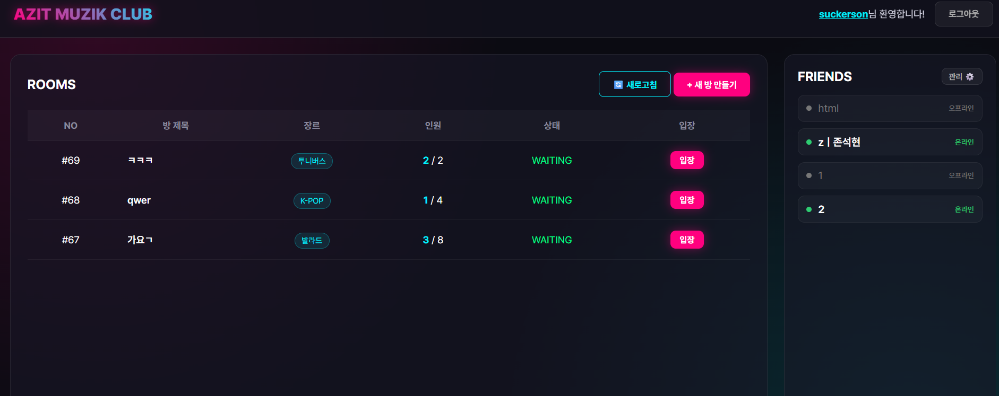
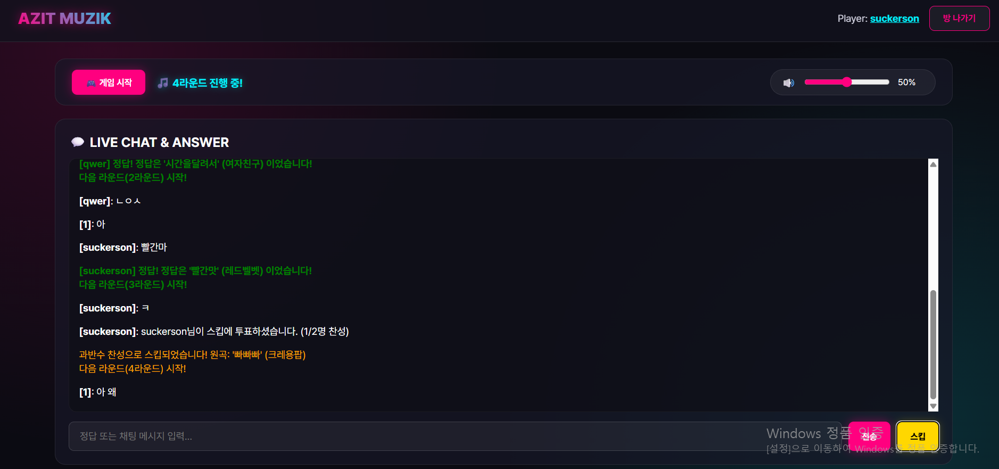
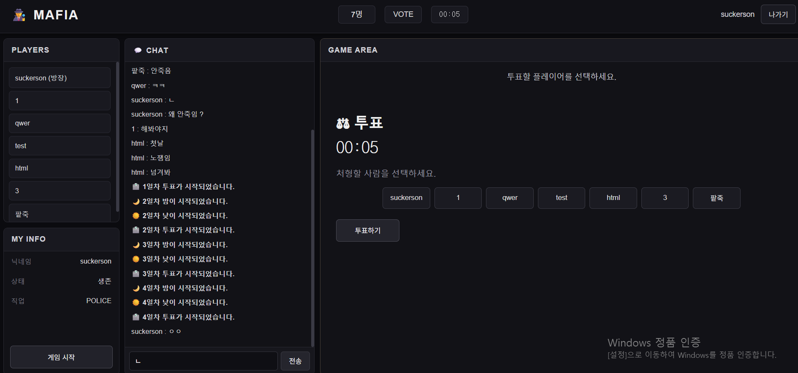
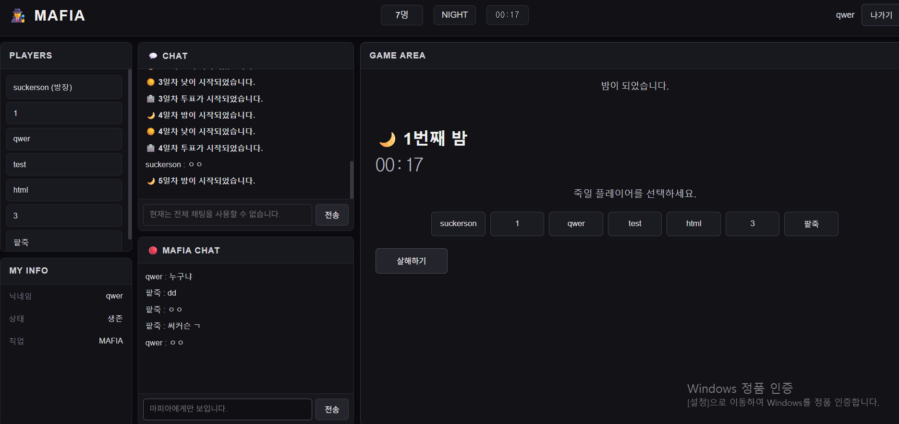
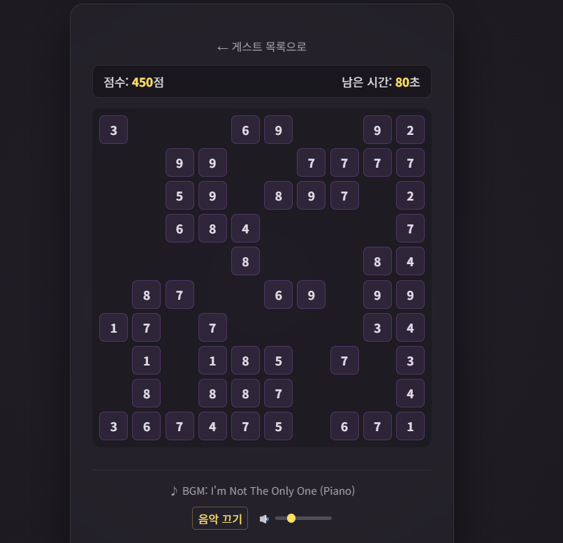
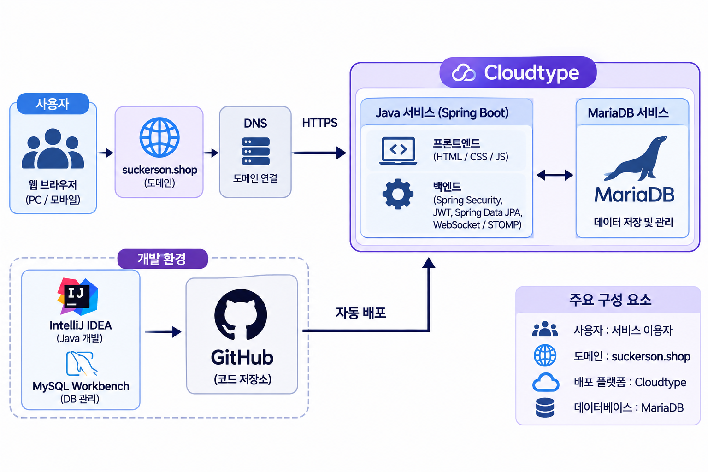
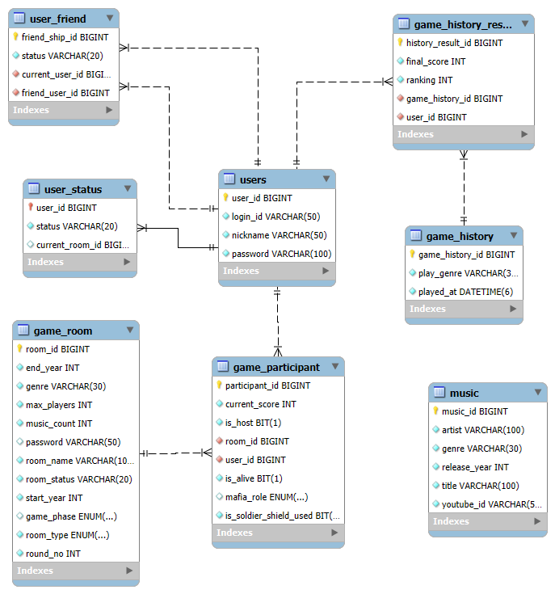

# Suckerson's AZIT

**서비스 바로가기:** [https://suckerson.shop](https://suckerson.shop)

Suckerson's AZIT는 실시간 멀티플레이 게임과 다양한 미니 서비스를 제공하는 웹 서비스입니다.

## Navigation

- [프로젝트 소개](#프로젝트-소개)
- [주요 기능](#주요-기능)
- [서비스 화면](#서비스-화면)
- [기술 스택](#기술-스택)
- [시스템 아키텍처](#시스템-아키텍처)
- [주요 구현](#주요-구현)
- [데이터베이스](#데이터베이스)
- [트러블슈팅](#트러블슈팅)
- [배포](#배포)
- [프로젝트 정보](#프로젝트-정보)

---

## 프로젝트 소개

Suckerson's AZIT는 실시간 멀티플레이 게임과 다양한 미니 서비스를 제공하는 웹 서비스입니다.

사용자는 회원가입 및 로그인을 통해 다른 사용자와 함께 게임을 즐길 수 있으며 WebSocket 기반의 실시간 통신을 통해 게임 진행 상황과 채팅 메시지를 주고받을 수 있습니다.

현재 노래 제목 맞히기와 마피아 게임을 제공하며 별도의 로그인 없이 이용할 수 있는 룰렛, 숫자 조합 게임, Inst 설정 등의 미니 서비스도 구현했습니다.

**주요 서비스 구성**
- **실시간 멀티플레이 게임**: 노래 제목 맞히기(혼자도 가능), 마피아 게임
- **미니 서비스**: 룰렛, 숫자를 드래그하여 합 10 만들기, Inst 설정
---

## 주요 기능

### 1. 노래 제목 맞히기

- **게임방 생성**: 사용자는 장르, 년도설정, 방이름, 노래 개수, 인원을 설정하여 게임방을 생성합니다.
- **게임방 관리**: 사용자가 게임방을 생성하거나 기존 방에 참여할 수 있습니다.
- **실시간 채팅**: 게임이 시작되면 참가자들이 채팅으로 노래 제목을 입력하고 정답을 맞힙니다.
- **게임 진행 관리**: 시작버튼으로 게임을 시작하고 참가자들이 곡을 skip하는 등의 게임 진행을 관리합니다.
- **게임 결과**: 설정한 곡 수만큼 게임을 진행한 후 결과와 순위를 확인할 수 있습니다.

### 2. 마피아 게임

- **게임방 생성**: 사용자는 방이름과 인원(최소 4명,최대 12명) 수 를 설정하여 게임방을 생성합니다.
- **참가자 및 역할 관리**: 참가자 수에 따라 마피아와 경찰, 의사, 특수직업 등의 역할을 배정합니다.
- **게임 페이즈 관리**: 밤, 낮, 투표, 반론시간 등 단계별로 게임을 진행합니다.
- **역할별 행동**: 마피아의 공격, 의사의 치료, 경찰의 조사, 특수직업 능력 등 역할에 따른 행동을 처리합니다.
- **승패 판정**: 게임 규칙에 따라 생존자와 역할을 확인하고 승리 팀을 결정합니다.

### 3. 미니 서비스

- **룰렛**: 입력한 항목을 바탕으로 무작위 결과를 확인할 수 있습니다.
- **숫자 조합 게임**: 숫자를 드래그하여 합이 10이 되도록 조합합니다.
- **Inst 설정**: 원하는 Inst 관련 설정을 이용할 수 있습니다.
---

## 서비스 화면

### 방 목록

게임 로비(현재는 muzik 화면)

### 음악 퀴즈
muzik 플레이 화면

### Mafia 게임

mafia 플레이 화면(마피아 제외 직업 화면)

---
mafia 플레이 화면(마피아 전용 화면)

### 비로그인 서비스
드래그로 10을 맞추는 미니 게임

---

## 기술 스택

### Backend

- Java 17
- Spring Boot
- Spring Security
- Spring Data JPA
- JWT
- WebSocket / STOMP

### Frontend

- HTML
- CSS
- JavaScript

### Database

- MySQL

### Deployment

- Cloudtype

### Development Tools
- IntelliJ IDEA
- MySQL Workbench
- Swagger UI
- Postman

---

## 시스템 아키텍처

---

## 주요 구현

### JWT 인증

- Spring Security를 활용한 URL별 접근 권한 설정
- JWT Access Token 발급 및 유효성 검증
- Authorization 헤더의 Bearer Token을 통한 사용자 인증
- 인증된 사용자의 ID와 로그인 정보를 활용한 API 처리
- Stateless 방식으로 세션을 사용하지 않는 인증 구조 구현

### WebSocket / STOMP

- WebSocket과 STOMP를 활용한 실시간 양방향 통신 구현
- STOMP 메시지 발행 및 구독 경로 설정
- JWT를 활용한 WebSocket 연결 사용자 식별
- 게임방 참가 여부 및 직업에 따른 구독 권한 검사

### muzik 퀴즈

- 장르, 발매 연도 및 문제 수에 따른 랜덤 퀴즈 출제
- YouTube 영상 ID를 활용한 음악 퀴즈 진행
- 정답 판정 및 참가자별 점수 관리
- 과반수 스킵 투표를 통한 라운드 진행
- 게임 종료 후 점수 및 순위 기록 저장

### 마피아 게임 서버

- 직업별 밤 행동 및 공격·치료·조사 결과 처리
- 생존 상태에 따른 게임 행동 제한
- 1차 처형 대상 지목 및 최후 반론 찬반 투표 구현
- 투표 결과에 따른 처형 및 승리 조건 판정
- 게임 페이즈와 생존 상태에 따른 채팅 접근 제어
- 특정 직업 전용 화면 및 행동 결과 발송

### 마피아 게임 페이즈 및 타이머 관리

- WAITING, NIGHT, DAY, VOTE, DEFENSE 단계별 게임 진행 관리
- ThreadPoolTaskScheduler를 활용한 페이즈 자동 전환
- 참가자 수에 따른 페이즈별 제한 시간 설정
- STOMP를 통한 게임 상태 변경 실시간 전송
- 게임 종료 시 방별 타이머 정리
---

## 데이터베이스

### ERD

### 주요 테이블

| 테이블명 | 설명 |
|---|---|
| `users` | 회원 정보 및 로그인 정보 관리 |
| `user_status` | 사용자 접속 상태 및 현재 참여 중인 방 정보 관리 |
| `user_friend` | 사용자 간 친구 관계 및 친구 요청 상태 관리 |
| `game_room` | 게임방 정보, 게임 설정 및 진행 상태 관리 |
| `game_participant` | 게임방 참가자 정보, 점수, 역할 및 생존 상태 관리 |
| `game_history` | 게임 플레이 기록 관리 |
| `game_history_result` | 사용자별 최종 점수 및 순위 관리 |
| `music` | 노래 제목, 가수, 장르, 발매 연도 및 YouTube 영상 정보 관리 |

---

## 트러블슈팅

### 배포 환경 문제

작성 예정

### DB 데이터 불일치

작성 예정

### 사용자 ONLINE / OFFLINE 상태 문제

작성 예정

### MySQL Safe Update Mode

작성 예정

---

## 배포

### 서비스 주소

https://suckerson.shop

### 배포 환경

- Cloudtype

---

## 프로젝트 정보

### 개발 기간

- 2026년 8월 ~ 현재 (개발 및 운영 중)

### 개발 인원

- 1명

### 담당 역할
- Java와 Spring Boot 기반 백엔드 개발
- HTML, CSS, JavaScript 기반 프론트엔드 개발
- REST API 및 서비스 로직 구현
- JPA를 활용한 데이터베이스 연동 및 데이터 관리
- JWT 기반 인증 구현
- WebSocket·STOMP 기반 실시간 통신 구현
- 실시간 멀티플레이 게임 로직 개발
- 웹 서비스 배포 및 운영
